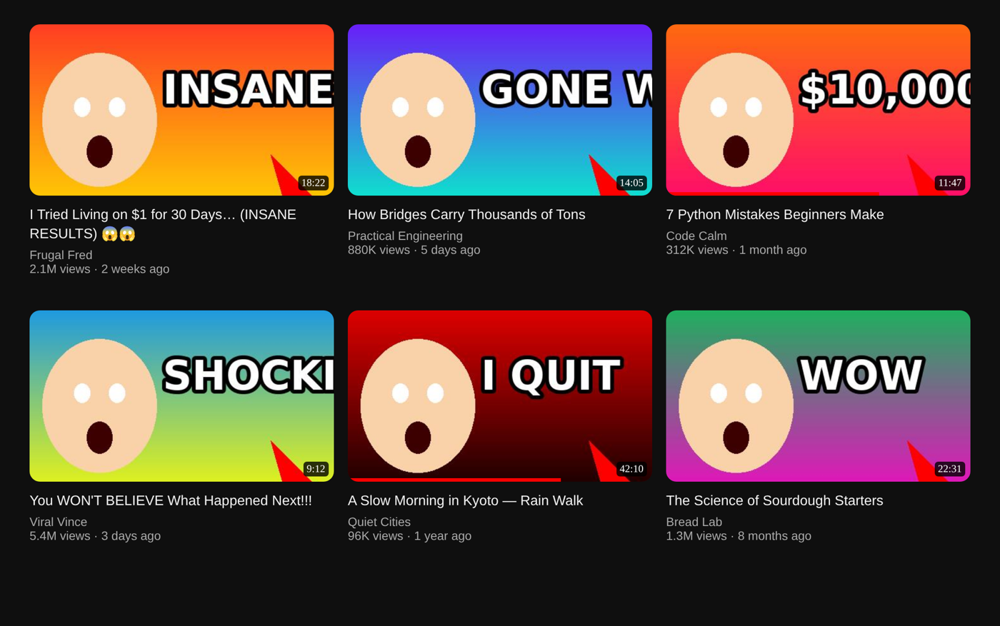
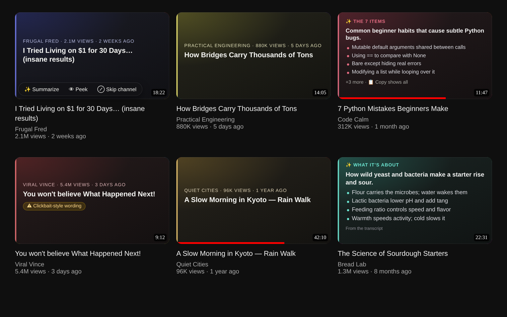
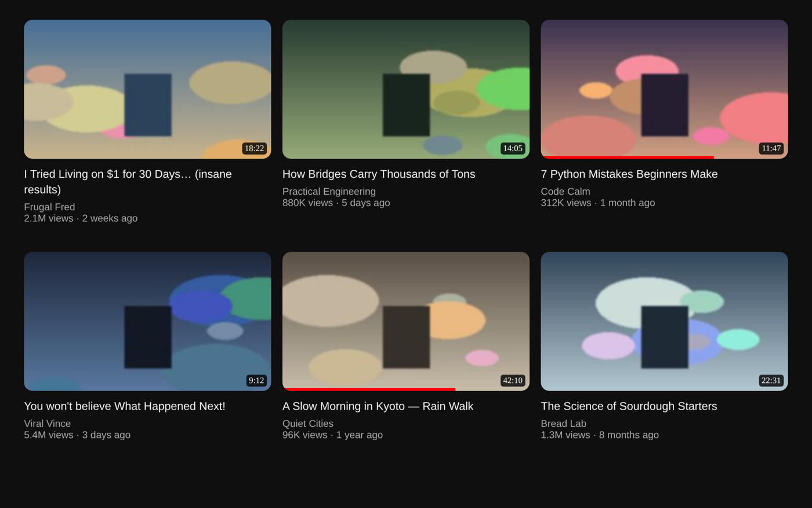
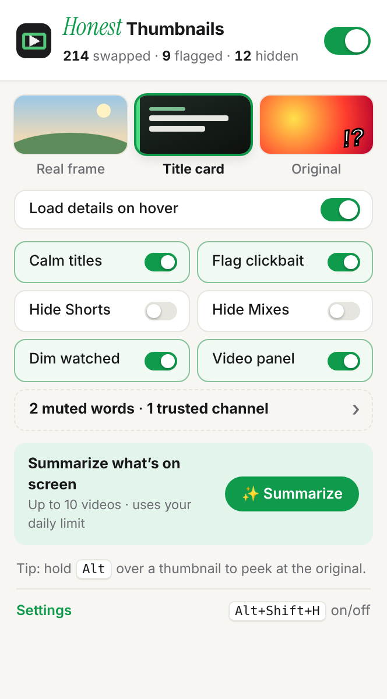
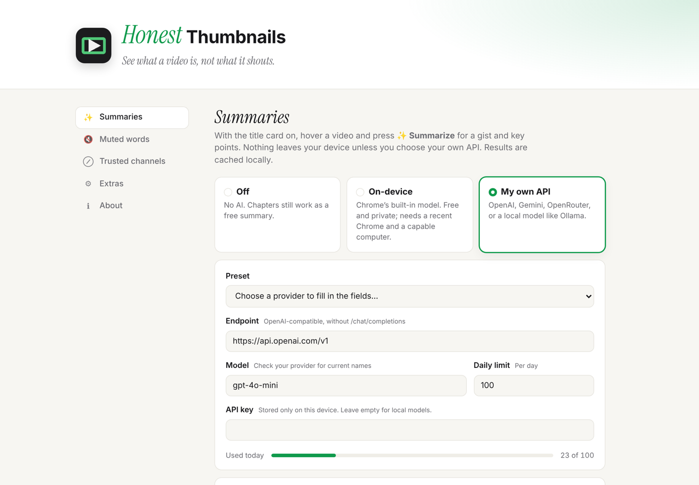

# *Honest* Thumbnails for YouTube

[](https://chromewebstore.google.com/detail/honest-thumbnails-for-you/plegclkjncdlclphhfhdidbbomlbmndc)
[](https://chromewebstore.google.com/detail/honest-thumbnails-for-you/plegclkjncdlclphhfhdidbbomlbmndc)

**See what a video is, not what it shouts.** Honest Thumbnails swaps over-edited, clickbait YouTube
thumbnails for a real frame from the video or a clear title card, and calms down shouty titles.

Free and open source. No accounts, no analytics, no servers of ours: everything runs in your browser.

| Before | After |
|---|---|
|  |  |

<sub>Videos, channels and thumbnails in these images are made up for the demo.</sub>

## What it does

**Thumbnails**
- **Real frame:** an early, middle or late frame from the video instead of the designed thumbnail.
- **Title card:** title, channel, views and age in a card tinted per channel. On hover: likes, chapter count,
  a ⚠ clickbait-wording flag and, optionally, sponsor time from SponsorBlock.
- **👁 Peek:** hold `Alt` over a thumbnail (or press and hold 👁 Peek) to see the original for a moment.

**Titles**
- **Calm titles:** removes ALL CAPS shouting, emoji spam and "!!!".
- **Clickbait flag:** marks titles that use well-known clickbait phrasing.

**Summaries (optional)**
- **✨ Summarize:** a one-line gist plus key points. If the title promises "5 tips" or "Top 7 apps", it lists those items.
  Uses Chrome's built-in on-device model, or *your own* API key or local model (OpenAI, Gemini, OpenRouter, Ollama, LM Studio).
  Settings shows whether the built-in model can run on your computer, and **Save and test** checks your own service.
- **📑 Chapters as a free summary:** no AI needed when a video has chapters.
- **Video-page panel:** the same summary, chapters and a copy button under the player.
- **Summarize visible:** one confirmed click summarizes up to 10 videos on screen, within your daily limit.

**Your feed, your rules**
- Hide **Shorts** and **Mixes**, **dim watched** videos, **mute words** in titles or channel names.
- **Trusted channels:** hover a thumbnail and press ⊘ Skip channel to leave a channel's thumbnails alone.
- **Today's numbers** in the popup: thumbnails swapped, titles flagged, videos hidden.
- **Pause for 1 hour** from the popup when you want plain YouTube for a while; it switches back on by itself.
- **Alt+Shift+H** turns everything on or off (change it at `chrome://extensions/shortcuts`). The toolbar icon turns grey while it's off or paused.



<p>
  
  
</p>

## Install

**[Add to Chrome from the Chrome Web Store](https://chromewebstore.google.com/detail/honest-thumbnails-for-you/plegclkjncdlclphhfhdidbbomlbmndc)** (also works in Edge, Brave and Arc).

**From source**, for trying unreleased changes:
1. Download or clone this repository.
2. Open `chrome://extensions` and turn on **Developer mode** (top right).
3. Click **Load unpacked** and choose the `honest-thumbnails` folder.
4. A short welcome page opens. Pin the green *h*, open YouTube, and pick a look from the toolbar icon.

## Privacy

Nothing is collected. Settings live in Chrome's storage on your device (synced with your Chrome profile).
Summaries leave your device only if you choose your own API, and then only to the endpoint you entered.
Full details in [PRIVACY.md](PRIVACY.md).

## Develop

```
node tests/titles.test.js      # title cleaning, clickbait flag, muted words
node tests/info.test.js        # watch-page parsing, chapters, list detection
node tests/smoke.test.js       # content script starts against a stub browser
./package.sh                   # builds dist/honest-thumbnails-<version>.zip for the Chrome Web Store
```

| Path | What it is |
|---|---|
| `src/content.js` | Page logic: thumbnails, title cards, hover bar, watch panel |
| `src/titles.js`, `src/info.js` | Pure, tested helpers |
| `src/background.js` | Calls your AI endpoint and SponsorBlock; keyboard shortcut |
| `popup/`, `options/`, `ui/` | Popup, settings page and their shared styles |
| `store/` | Chrome Web Store screenshots and promo tile |
| `CHROMEWEBSTORE.md` | Store listing, permission justifications, privacy disclosures, release checklist |

YouTube changes its markup often; selectors live at the top of `src/content.js`.

## Known limits

- Captions can be blocked for some requests; the summary then uses the description (the card says which).
- Chrome's built-in model depends on your Chrome version and hardware.
- Frames are picked automatically, so an early frame may be an intro or a black screen: try Middle.
- Hover previews still play the real video in frame mode. Shorts are left untouched.

## Credits

Made by **Subrahmanyam KVJ**. Wordmark set in [Instrument Serif](https://github.com/Instrument/instrument-serif)
(SIL Open Font License). Optional sponsor data from the [SponsorBlock](https://sponsor.ajay.app) community.
Not affiliated with YouTube or Google.

MIT licensed. See [LICENSE](LICENSE).
